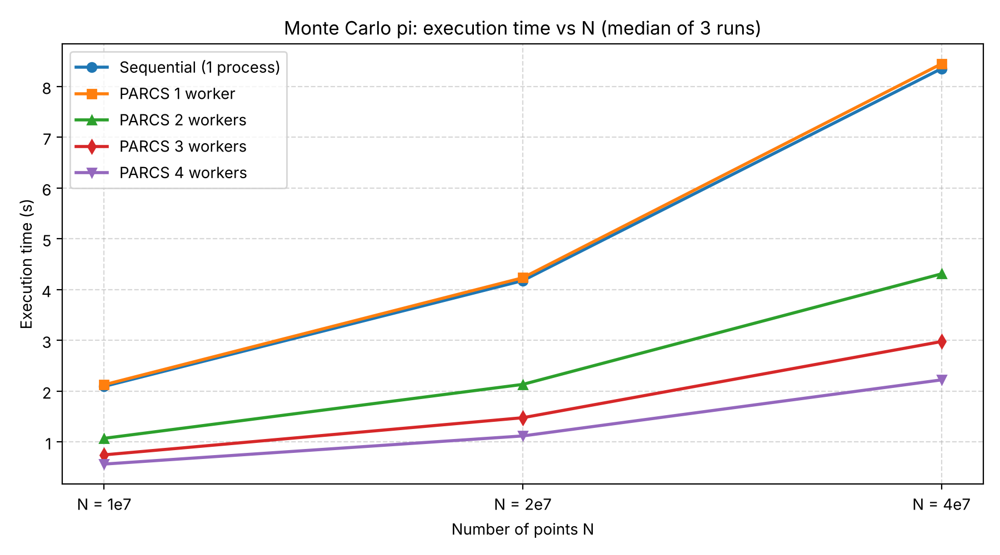
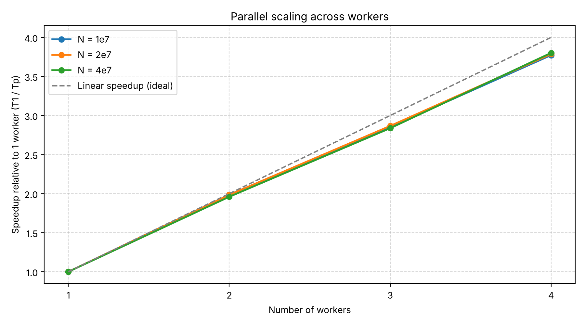

# PARCS Monte Carlo — паралельне обчислення числа π у Google Cloud

Лабораторна робота №1 з дисципліни «Хмарні обчислення» (КНУ ім. Т. Шевченка, ФКНК).
Виконав: Коровін Микита, група ТК-42.

Число π оцінюється методом Монте-Карло: у квадрат [0;1)×[0;1) кидаються N випадкових точок,
рахується кількість M точок усередині чверті кола x² + y² ≤ 1, тоді π ≈ 4·M/N.
Паралельна версія працює в системі [PARCS-Python](https://github.com/Hummer12007/parcs-python)
за схемою map-reduce: майстер ділить N точок між p воркерами (кожен зі своїм зерном генератора
`seed + i`), воркери незалежно рахують свої Mᵢ, майстер підсумовує їх.

## Структура

| Файл | Призначення |
|---|---|
| `solution.py` | паралельна версія для PARCS: клас `Solver` з методами `solve`, `mymap`, `myreduce` (Python 2.7/3) |
| `sequential.py` | послідовна версія (еталон) |
| `local_test.py` | локальна перевірка `solution.py` без кластера (воркери імітуються процесами) |
| `input/input_10M.txt`, `input_20M.txt`, `input_40M.txt` | вхідні дані: N і seed |
| `tools/gcp_up.sh`, `tools/gcp_down.sh` | створення / видалення кластера в Google Cloud |
| `tools/run_all.sh` | автоматична серія вимірювань через REST API майстра PARCS |
| `results/summary.csv` | усі виміри (36 паралельних і 9 послідовних запусків) |
| `results/*.png` | графіки часу виконання та прискорення |

## Запуск у Google Cloud Shell

```bash
bash tools/gcp_up.sh          # master + 4 workers (n1-standard-1, europe-central2-a)
bash tools/run_all.sh         # 4/3/2/1 воркери × N = 1e7, 2e7, 4e7 × 3 повтори + послідовна версія
bash tools/gcp_down.sh        # видалити VM
```

Примітки з розгортання:
- Container-Optimized OS має власний iptables-фаєрвол, тому startup-скрипт виконує
  `iptables -I INPUT -j ACCEPT`, інакше воркери не можуть зареєструватися у майстра.
- На пробному акаунті квота — 4 зовнішні IP у регіоні. П'ятий вузол створюється після видалення
  зовнішньої IP в одного з воркерів (`gcloud compute instances delete-access-config parcs-worker-4
  --access-config-name="external-nat"`); воркерам вона потрібна лише для завантаження Docker-образу.
- Вебінтерфейс PARCS відкривався через SSH-тунель і Web Preview у Cloud Shell:
  `gcloud compute ssh parcs-master -- -f -N -L 127.0.0.1:8080:localhost:8080`.

Локальна перевірка: `pip install Pyro4 && python3 local_test.py`.

## Результати (медіана 3 прогонів, Total time, с)

| Конфігурація | N = 10⁷ | N = 2·10⁷ | N = 4·10⁷ |
|---|---|---|---|
| Послідовна версія | 2,094 | 4,177 | 8,351 |
| PARCS, 1 воркер | 2,126 | 4,233 | 8,446 |
| PARCS, 2 воркери | 1,071 | 2,133 | 4,310 |
| PARCS, 3 воркери | 0,745 | 1,477 | 2,977 |
| PARCS, 4 воркери | 0,564 | 1,118 | 2,223 |

Прискорення на 4 воркерах відносно одного воркера — 3,77–3,80 (ефективність ≈ 95 %),
відносно послідовної версії — 3,72–3,76. Накладні витрати PARCS для цієї задачі ≈ 1 %:
воркер отримує і повертає лише два числа.



